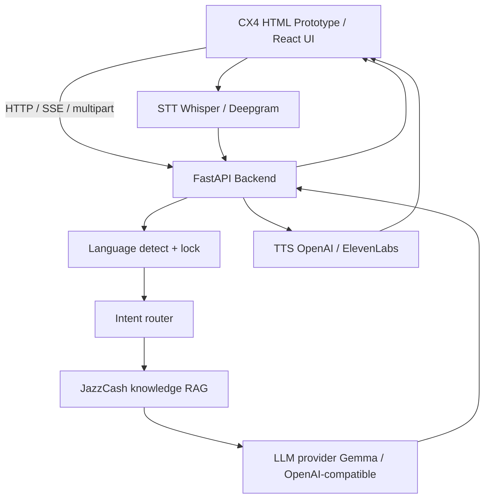

# JazzCash AI Assistant

Concept demo of a bilingual JazzCash-style mobile assistant. It understands English and Urdu (script + Roman), answers with an LLM, pulls from a small RAG knowledge base, and can do voice in and voice out. Nothing here moves real money.

Live demo (Render): https://jazzcash-ai-assistant.onrender.com

## What you get

- Phone-frame UI with chat, guided flows (send, bills, top-up, loans, failed payment recovery)
- Separate app language toggle (whole UI) and chat language toggle (replies + LLM)
- FastAPI agent pipeline: language lock -> intent -> RAG -> LLM -> structured reply
- Optional STT / TTS when you plug in OpenAI-compatible keys
- Safety: transaction execution intents are blocked so the bot never pretends cash moved

## Architecture



## Repo layout

```
backend/     FastAPI app, agents, RAG, STT/TTS providers
frontend/    CX4 HTML prototype + Vite React shell
scripts/     local helpers
render.yaml  Render deploy blueprint
```

## Run locally

**Backend**

```bash
cd backend
python -m venv .venv
source .venv/bin/activate
pip install -r requirements.txt
cp .env.example .env   # fill keys if needed
uvicorn main:app --reload --host 0.0.0.0 --port 8000
```

- Health: http://127.0.0.1:8000/api/health
- Docs: http://127.0.0.1:8000/docs
- Prototype: http://127.0.0.1:8000/

**Frontend (optional React shell)**

```bash
cd frontend
npm install
npm run dev
```

## LLM notes

Default config points at Jazz AIOps Gemma (`LLM_BASE_URL` / `LLM_MODEL` in `.env`). On public hosts like Render that endpoint may not be reachable. Swap to any OpenAI-compatible base URL if you need cloud demos.

## License / disclaimer

Demo only. Names, balances, and bills are generated. Not an official JazzCash product.
